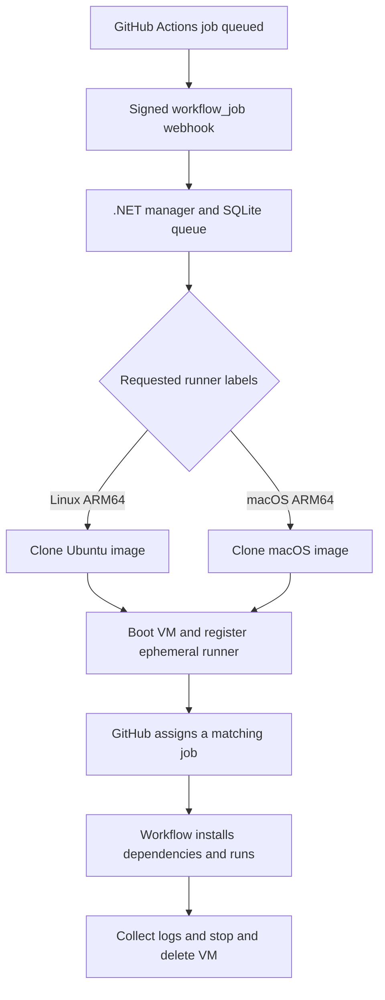

In [my earlier article about running a small GitHub Actions runner fleet on macOS](/blog/2026-macos-github-actions-runner-fleet), I put an existing Mac mini to work with a dedicated service account, separate runner directories, and a LaunchDaemon for each worker. It gave me useful CI capacity without adding another machine.

Those runners also reused their environments. Every build inherited a machine that previous builds had already touched: installed SDKs, package caches, workspaces, temporary files, and whatever else a workflow left behind. Separate directories made that manageable, but I wanted a cleaner starting point for each job and a stronger boundary between build code and the host.

The next version uses disposable Linux and macOS virtual machines, with Tart providing the VM layer and a .NET service coordinating their lifecycle. Linux handles the work that can run there; macOS is reserved for jobs that actually need Apple tooling.

<!-- truncate -->

## What I Want to Change

The original fleet solved the immediate capacity problem. This iteration is about making the build environment predictable.

I want each job to start from a known image, install the dependencies declared by its workflow, execute once, and leave behind logs and artifacts rather than a modified runner. The physical Mac should host the VM manager and its infrastructure, while application builds happen inside guests.

That changes three things:

- **Lifetime:** a runner belongs to one job. Its VM is discarded afterward.
- **Isolation:** build commands modify the guest rather than the host's SDK installations or home directory.
- **Configuration:** the repository declares the SDKs, runtimes, and workloads it needs instead of relying on something I installed on the Mac months ago.

There is a cost: booting guests and preparing dependencies takes time. I am choosing a reproducible baseline over an indefinitely warm environment, then adding deliberate caching where it helps.

## The Simpler Options I Considered

### Apple Containers for Linux Jobs

[Apple's `container` project](https://github.com/apple/container) runs Linux containers in lightweight VMs on Apple Silicon. It is attractive for a Linux runner pool without Docker Desktop, especially when the jobs mostly run shell commands such as `dotnet build` or `npm ci`.

That would let me use an existing container runtime for environment creation and disposal. It would still need something to register GitHub runners and replace them after jobs. More importantly for this setup, Apple Containers provide Linux guests; they do not provide the macOS environment needed for Xcode builds.

It remains a useful option if the scope is Linux CI. I wanted one VM lifecycle model that could cover both operating systems.

### Cilicon for macOS Jobs

[Cilicon](https://github.com/traderepublic/Cilicon) is an existing application for ephemeral macOS CI on Apple Silicon. Its focus fits the Apple build side of this problem well, and it is worth evaluating before writing a runner manager for a macOS-only workload.

My fleet also builds things that do not need macOS: backend services, web applications, and general automation. Using a full macOS image with Apple tooling for all of those jobs would allocate resources to an environment they do not require.

### Why I Want Both Linux and macOS

For this machine, my intended default is a smaller Linux image for general builds, with a separate macOS image for Xcode, Apple SDKs, and platform-specific workloads. That should leave more memory and disk headroom for useful work than giving every job an Xcode-equipped guest. I have not benchmarked the difference yet; this is a resource allocation decision rather than a measured performance claim.

Linux jobs still consume real CPU, memory, storage, and boot time. The goal is to allocate an appropriate environment for each workload, and cap total concurrency so the Mac stays healthy.

## One VM Layer, Two Images

[Tart supports creating and running both Linux and macOS VMs on Apple Silicon](https://tart.run/quick-start/). That gives me a common set of clone, start, stop, and delete operations while keeping separate guest images.

The design looks like this:



The manager provisions capacity. GitHub still assigns jobs to eligible runners according to their labels and runner groups. A VM created in response to one queued job is not inherently bound to that particular job; another eligible job can reach it first. The manager needs to track the runner that actually executes each job.

There are two useful milestones here. We have prepared the guest images and confirmed a manually registered Ubuntu ephemeral runner can execute a GitHub Actions job. An initial .NET 10 manager solution has also been generated, but at the time of writing it still needs compilation and end-to-end validation on the Mac. The walkthrough below separates that working manual path from the automation being built around it.

## 1. Prepare Golden Images

Install Tart on the host using its documented Homebrew tap:

```bash
brew install cirruslabs/cli/tart
tart list
```

Our local images are named `ubuntu` and `macos27xcode`. These are local names from this setup, not image identifiers readers should expect to find in a registry. In particular, the macOS image name is not a version requirement for this design.

Before following the remaining commands, create or obtain compatible ARM64 images using the [Tart image preparation instructions](https://tart.run/quick-start/#creating-vm-images), then prepare each guest with:

- A dedicated guest account and SSH access for the manager.
- Git, the GitHub Actions runner's prerequisites, and an OS-appropriate ARM64 runner distribution.
- An installed but **unregistered** runner, with no previous job workspace or registration credentials.
- A reviewed OS baseline; the macOS image also includes the selected Xcode installation and its required setup.

For the examples, the guest account is `admin`, the runner lives in `~/actions-runner`, and the host uses a dedicated SSH key at `~/.ssh/tart-runner`. Adjust those to match your images. Verify SSH host identities rather than disabling host key checks globally.

Shut down the prepared guests before treating them as golden images. Jobs run in clones; the source images stay available for the next job. Image updates should be intentional and tested, with a way to identify which image revision a job used.

I want expensive platform setup such as Xcode in the image. Project-specific SDK selection belongs in the workflow. That keeps the image useful across repositories without turning it into a collection of every dependency every project has ever used.

## 2. Prove the Runner Lifecycle Manually

Before automating VM creation, I tested the smaller loop: clone a VM, register one runner, execute one job, and remove the VM.

On the Mac, clone the prepared Ubuntu image and start it:

```bash
tart clone ubuntu runner-test-001
tart run --no-graphics runner-test-001
```

Leave the VM process running. In another host terminal, find the guest and connect:

```bash
tart ip runner-test-001
ssh -i ~/.ssh/tart-runner admin@$(tart ip runner-test-001)
```

In the GitHub organization's **Settings → Actions → Runners → New self-hosted runner**, select Linux and ARM64 and obtain a temporary registration token. For this setup the organization is `lod-softworks`; substitute your own organization when following along.

Inside the guest, enter the token without recording it literally in shell history, then register the runner:

```bash
cd ~/actions-runner
read -r -s -p 'Registration token: ' RUNNER_REGISTRATION_TOKEN
printf '\n'

./config.sh \
  --url https://github.com/lod-softworks \
  --token "$RUNNER_REGISTRATION_TOKEN" \
  --name tart-linux-test-001 \
  --labels tart \
  --ephemeral \
  --unattended

unset RUNNER_REGISTRATION_TOKEN
./run.sh
```

This example uses Bash in the Ubuntu guest. The token is still passed to the registration process, so the guest should be treated as sensitive during bootstrap and command arguments must be redacted from manager logs.

The runner should appear in GitHub with `self-hosted`, `Linux`, `ARM64`, and the custom `tart` label. Trigger a small workflow in an authorized organization repository:

```yaml
name: Test Tart Runner

on:
  workflow_dispatch:

permissions:
  contents: read

jobs:
  test:
    runs-on: [self-hosted, Linux, ARM64, tart]
    timeout-minutes: 10
    steps:
      - name: Verify guest environment
        run: |
          echo "Runner: $RUNNER_NAME"
          echo "OS: $RUNNER_OS"
          uname -a
          whoami
      - name: Complete the test
        run: echo "Ephemeral Tart runner works!"
```

The expected result is a successful job followed by the runner process exiting and its registration disappearing. [GitHub's ephemeral runner option](https://docs.github.com/en/actions/reference/runners/self-hosted-runners#ephemeral-runners-for-autoscaling) limits that registration to a single job.

The VM itself is still there. Once the job has finished, return to the Mac and remove the disposable guest:

```bash
tart stop runner-test-001
tart delete runner-test-001
```

That was the manual Ubuntu test path. The macOS image needs the same job-and-cleanup validation before I treat both pools as ready.

## 3. Make the Workflow Declare Its Dependencies

A fresh VM quickly reveals hidden dependencies. If `dotnet build` worked only because I installed an SDK interactively on the old host, the workflow needs to say which SDK it expects.

For example, a Linux .NET build can explicitly install its SDK with [`actions/setup-dotnet`](https://github.com/actions/setup-dotnet):

```yaml
name: Build .NET

on:
  workflow_dispatch:
  push:
    branches: [main]

permissions:
  contents: read

jobs:
  build:
    runs-on: [self-hosted, Linux, ARM64, tart]
    timeout-minutes: 30
    steps:
      - uses: actions/checkout@v4
      - name: Install .NET SDK
        uses: actions/setup-dotnet@v5
        with:
          dotnet-version: '10.0.x'
      - run: dotnet restore
      - run: dotnet build --configuration Release --no-restore
      - run: dotnet test --configuration Release --no-build
```

The image must contain a runner version compatible with the actions being used. For a repository with `global.json`, I would use `setup-dotnet`'s `global-json-file` input so local development and CI read the same SDK selection. A floating patch version is convenient; an exact version gives tighter reproducibility.

Node projects should similarly select their Node version, install dependencies from the lockfile, and run their build. A MAUI job should declare its workload installation or restoration and target `macOS` instead of `Linux` when Apple tooling is required. Xcode selection and signing assets need explicit treatment too.

Caching can reduce repeated downloads, but a cache should be an optional acceleration. A missing cache must still result in a correct build. I also want caches separated by OS, architecture, and dependency inputs rather than sharing writable host directories across every guest.

## 4. Automate It with a .NET Manager

The manual process establishes what the service needs to automate. The initial manager design uses ASP.NET Core on .NET 10, SQLite for durable job and VM records, and `launchd` to keep the host service running.

GitHub's [`workflow_job` event](https://docs.github.com/en/webhooks/webhook-events-and-payloads#workflow_job) supplies lifecycle notifications. The intended manager flow is:

1. Receive and validate the webhook, then durably record relevant job events.
2. Recognize this pool's labels and select the allowed Linux or macOS image.
3. Wait for available capacity, then record a unique VM name and clone the image.
4. Boot the guest and wait for SSH readiness with a timeout.
5. Obtain a fresh registration token and register a uniquely named ephemeral runner.
6. Track which job that runner actually accepts.
7. Collect diagnostics, remove the VM, and reconcile any leftover registration.

The label mapping is deliberately small:

| Required labels | Local image | Intended work |
| --- | --- | --- |
| `self-hosted`, `Linux`, `ARM64`, `tart` | `ubuntu` | General .NET, web, and automation jobs |
| `self-hosted`, `macOS`, `ARM64`, `tart` | `macos27xcode` | Xcode and Apple platform builds |

Labels are routing inputs. Repository access and runner groups still need to restrict who can use this infrastructure. Unknown label combinations should never turn into arbitrary image names or host commands.

The webhook handler should [validate `X-Hub-Signature-256`](https://docs.github.com/en/webhooks/using-webhooks/validating-webhook-deliveries) against the raw request body before accepting work. It should acknowledge promptly after durable recording, leaving VM startup to a background worker.

The planned SQLite records make that worker recoverable: delivery identity, job identity and attempt, requested labels, image, VM name, runner ID, state, timestamps, and failure details. Duplicate deliveries must not create duplicate capacity. Cancellations and reordered events must not resurrect completed work.

### Registration Tokens Are Created When Needed

The guest images do not contain registration tokens or organization API credentials. The manager authenticates to GitHub from the host and calls the [organization registration-token endpoint](https://docs.github.com/en/rest/actions/self-hosted-runners#create-a-registration-token-for-an-organization) after the guest becomes reachable.

That registration token expires after one hour. The expiry controls when it can be used to register; it does not impose a one-hour job limit after successful registration. If bootstrap fails long enough for the token to expire, the manager needs a new token.

A GitHub App installation token with the appropriate organization runner permissions is a suitable authentication path. Its renewal belongs in the manager. The VM gets only what it needs to register and execute its job, and credentials must stay out of persisted command logs.

### Cleanup Is Part of the Job

Normal completion is only one path. A VM may fail to boot, SSH may never appear, registration may fail, or the host may restart halfway through a build. The service needs bounded startup and job lifetimes, cleanup that can be retried, and reconciliation between SQLite, Tart, and GitHub on startup.

I want diagnostics retained outside the disposable guest before deletion, with limits on retention and disk usage. A cleanup failure should remain visible and keep consuming its reserved capacity until reconciled. Otherwise a supposedly small pool can accumulate orphaned VMs.

Those are validation requirements for the manager, not claims that every recovery path has already been exercised.

## Resource Limits and Isolation Still Matter

The Linux and macOS pools share one physical Mac. Separate pool limits need a shared host budget for memory, CPU, and disk headroom, including space for growing clone disks. I will start with conservative concurrency and measure boot times, peak memory, and actual job duration before increasing it. macOS guest licensing and platform limits also need to be respected.

Both images here are ARM64. Dependencies and third-party actions need to support that architecture. Docker-based actions and service containers also have their own requirements: [GitHub requires a Linux runner with Docker installed](https://docs.github.com/en/actions/reference/runners/self-hosted-runners#requirements-for-self-hosted-runner-machines). Tart alone does not provide that runtime; on this M2 setup I would validate that capability separately rather than assume it works inside the guest.

VMs improve separation from the host, but shared folders, network access, SSH credentials, and signing secrets can cross that boundary. My default is no writable host home-directory mounts and no host management credentials in job environments. I still need to control which repositories and workflow changes may execute here.

## Where This Leaves the Fleet

The original LaunchDaemon fleet was a practical way to get builds running. This design keeps the Mac mini useful while moving build state into guests that can be thrown away.

The Ubuntu test established the single-job runner path. The next milestone is compiling and validating the manager on the host, exercising the macOS path, and testing recovery and cleanup before replacing the persistent fleet. The target is a small system whose behavior is easy to inspect: choose the right image, boot a clean guest, run one job, retain the evidence, and remove the environment.
